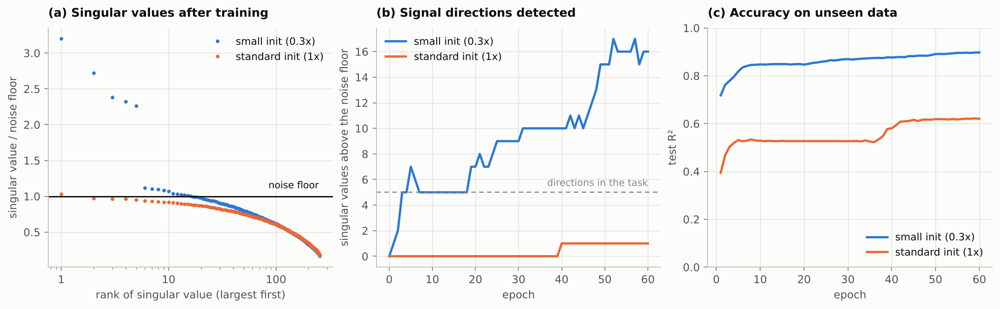
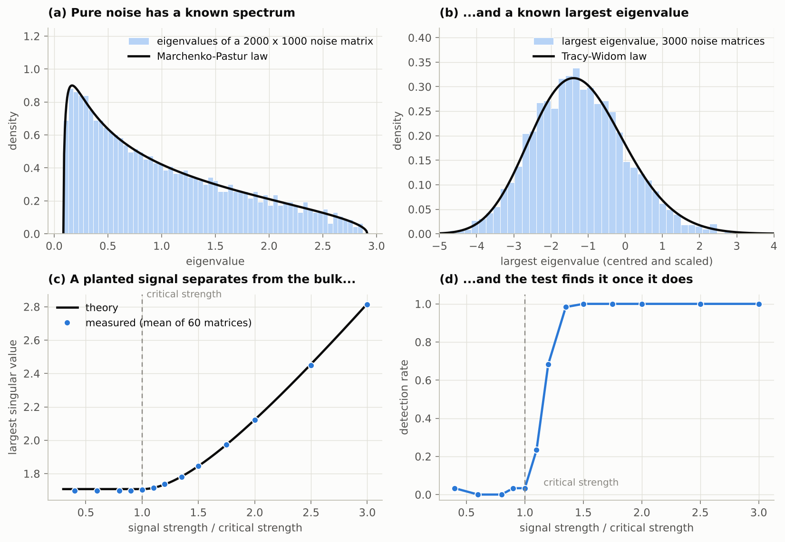
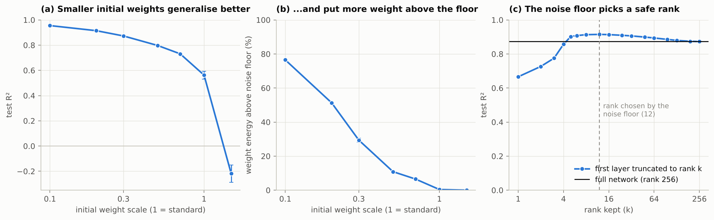
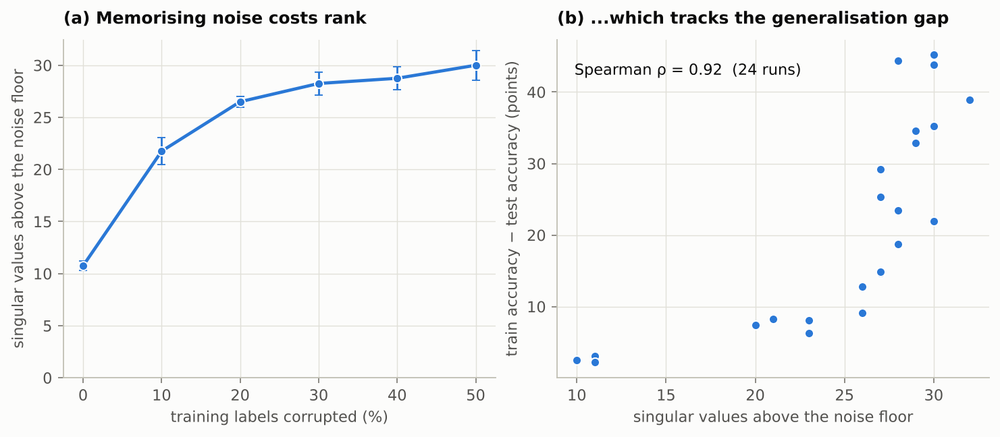

# noisefloor


**How much of a trained network's weights is signal, and how much is leftover noise?**
A random-matrix answer, written from scratch in NumPy.

A weight matrix starts as random numbers. Random matrix theory says exactly what the
singular values of a pure-noise matrix look like, and how far the largest one can
stray. Anything above that *noise floor* cannot be explained by chance, so it must have
been learned. `noisefloor` measures the floor, counts what rises above it, and can strip
away the rest.



*Two identical networks learn the same task and both fit the training set (train R² above
0.99). They differ only in the scale of their initial weights. One ends with weights that
still look like noise; the other stores what it learned in a few directions that stand
clear of the floor, and generalises much better.*

## Findings

Every number below is produced by `python experiments/run_all.py` and stored in
[`results/results.json`](results/results.json).

**1. The detector agrees with theory.** On synthetic matrices where the truth is known,
pure noise follows the Marchenko-Pastur law, its largest eigenvalue follows the
Tracy-Widom law, and a planted signal becomes visible at the predicted critical strength.

| Check | Result |
|---|---|
| False-alarm rate on pure noise (nominal 1%) | 1.4% to 1.7% across four matrix shapes |
| Largest singular value of signal + noise vs. theory | within 0.011 over 13 signal strengths |
| Detection rate at 1.35x the critical strength | 98% |
| Detection rate below the critical strength | 0% to 3% |



**2. The same task can be learned with or without leaving a trace in the weights.** A
512-unit network learns a target that depends on 5 directions of a 256-dimensional input.

| | Standard initialisation | Initial weights scaled by 0.3 |
|---|---|---|
| Train R² | 0.997 | 0.998 |
| Test R² | 0.620 | 0.897 |
| Singular values above the floor after 10 epochs | 0 | 5 (the true number) |
| Largest eigenvalue, relative to the detection threshold | 1.07 | 10.2 |
| Share of the 5 true directions recovered from the weights alone | 0.13 | 0.96 |

With standard initialisation the network fits the data by nudging many random features
slightly (the "lazy" regime), and its first layer stays statistically indistinguishable
from noise. With small initial weights it learns the 5 directions themselves (the "rich"
regime). Weaker directions keep crossing the floor as training continues: 16 by epoch 60.

**3. The noise floor chooses a compression rank without any data.** In the rich regime,
keeping only the singular values above the floor is not just safe, it helps.

| First layer of the rich network (mean of 3 seeds) | Parameters | Test R² |
|---|---|---|
| Full, rank 256 | 131,072 | 0.873 |
| Truncated at the noise floor, rank 12 | 9,216 (14x fewer) | **0.915** |

The rank is picked from the weights alone: no validation set and no tuning. Test R²
improved in all three seeds. The effect weakens as the initial weights grow, and the
share of weight energy above the floor falls from 77% (scale 0.1) to 0% (scale 1.5).



**4. Memorisation shows up in the spectrum (real data).** A network is trained on 8x8
handwritten digits while a growing share of the training labels is corrupted. Every run
reaches 100% training accuracy, so the training loss cannot tell the runs apart. The
weights can: the number of singular values above the floor in the second layer rises from
11 (clean labels) to 30 (half the labels corrupted), and across 24 runs it tracks the gap
between training and test accuracy with a Spearman correlation of 0.92.



## Limitations

- **Scale.** All experiments use small fully-connected networks on a planted task and on
  8x8 digits, on a CPU. Nothing here has been verified on large or pretrained models.
- **Removing the bulk is only safe in the rich regime.** With standard initialisation the
  "noise" is doing real work as random features: removing it drops digits accuracy from
  97.5% to 23.3%. With initial weights scaled by 0.3 the same operation costs 0.3 points
  (96.8% to 96.5%). Finding 3 should be read with this in mind.
- **Assumptions.** The method assumes an i.i.d. noise bulk plus a signal whose rank is
  small compared with the matrix size. Many weak directions are undercounted, and
  heavy-tailed bulks (reported for large pretrained models by Martin & Mahoney) break the
  Marchenko-Pastur fit. The `ks_distance` field reports how well the bulk fits.
- **Finding 4 is a controlled sweep.** The correlation is driven by the label-noise level.
  It does not show that the statistic predicts generalisation in general.
- **None of the underlying ideas are new** (see References). This repository is a small,
  tested, readable implementation with controlled reproductions.

## Install and use

```bash
git clone https://github.com/JosephAnggono/noisefloor.git
cd noisefloor
pip install -e ".[dev]"
pytest -q                       # 36 tests, a few seconds
python examples/quickstart.py   # about 15 seconds
```

```python
import noisefloor as nf

report = nf.analyze(weight)            # any 2-D array, or a 4-D convolution kernel
report.n_spikes                        # singular values above the noise floor
report.signal_energy                   # share of the squared norm they carry
report.ks_distance                     # how well the rest fits pure noise

cleaned, _ = nf.denoise(weight)        # keep the signal, drop the bulk

# A whole model: any {name: array} mapping. PyTorch tensors are converted for you.
print(nf.format_reports(nf.analyze_model(model.state_dict())))
```

Output of `examples/quickstart.py` for the two networks above (30 epochs):

```text
standard init: test R^2 = 0.527
layer                          shape  spikes  rank %  signal E%     KS  eff.rank
layer1                       512x256       0     0.0        0.0  0.012     236.9

small init: test R^2 = 0.870
layer                          shape  spikes  rank %  signal E%     KS  eff.rank
layer1                       512x256       9     3.5       25.4  0.033     225.7
first layer cut to rank 9: test R^2 = 0.909
```

From the command line: `noisefloor weights.npz` prints the same table, and
`--denoise clean.npz` writes a copy with the bulk removed.

## How it works

1. **Spectrum.** Take the singular values of the weight matrix. Their squares, divided by
   the larger dimension, are the eigenvalues that the theory describes.
2. **Noise level.** Pure noise with a given variance has a known median eigenvalue.
   Matching the observed median gives a first, robust estimate of the variance. It is then
   refined with the average of all eigenvalues not flagged as signal
   ([`spectrum.estimate_noise`](src/noisefloor/spectrum.py)).
3. **Threshold.** The largest eigenvalue of a finite noise matrix fluctuates around the
   edge of the bulk according to the Tracy-Widom law. The threshold is the value that
   noise exceeds with 1% probability ([`tw.edge_threshold`](src/noisefloor/tw.py)).
4. **Count and clean.** Eigenvalues above the threshold are signal. `denoise` keeps them
   and can also shrink them to correct the upward bias that noise adds
   ([`denoise.shrink_singular_values`](src/noisefloor/denoise.py)).

## Reproduce the experiments

```bash
pip install -e ".[experiments]"
python experiments/run_all.py   # about 5 minutes on 2 CPU cores; fixed seeds
```

| Path | Contents |
|---|---|
| `src/noisefloor/mp.py`, `tw.py` | Marchenko-Pastur and Tracy-Widom laws |
| `src/noisefloor/spectrum.py` | noise estimation, spike detection, per-layer report |
| `src/noisefloor/denoise.py` | truncation and optimal shrinkage |
| `src/noisefloor/nn.py`, `data.py` | NumPy network (gradients checked by finite differences) and tasks |
| `experiments/` | one script per finding; `run_all.py` regenerates `results/` |
| `tests/` | 36 tests: theory, calibration, rank recovery, gradients, CLI |

## Next steps

- Run on pretrained PyTorch models, where heavy-tailed bulks are expected, and add a
  tail-aware noise model.
- Use the detected rank per layer to set LoRA / PiSSA adapter ranks, instead of one rank
  for every layer.
- Track the spectrum during fine-tuning as an early-stopping signal that needs no
  validation data.

## References

- Marchenko & Pastur (1967). Distribution of eigenvalues for some sets of random matrices. *Mat. Sb.*
- Johnstone (2001). On the distribution of the largest eigenvalue in principal components analysis. *Ann. Statist.*
- Baik, Ben Arous & Péché (2005). Phase transition of the largest eigenvalue for nonnull complex sample covariance matrices. *Ann. Probab.*
- Kritchman & Nadler (2009). Non-parametric detection of the number of signals. *IEEE Trans. Signal Process.*
- Benaych-Georges & Nadakuditi (2012). The singular values and vectors of low rank perturbations of large rectangular random matrices. *J. Multivariate Anal.*
- Chiani (2014). Distribution of the largest eigenvalue for real Wishart and Gaussian random matrices and a simple approximation for the Tracy-Widom distribution. *J. Multivariate Anal.*
- Gavish & Donoho (2014). The optimal hard threshold for singular values is 4/√3. *IEEE Trans. Inf. Theory.*
- Gavish & Donoho (2017). Optimal shrinkage of singular values. *IEEE Trans. Inf. Theory.*
- Zhang, Bengio, Hardt, Recht & Vinyals (2017). Understanding deep learning requires rethinking generalization. *ICLR.*
- Chizat, Oyallon & Bach (2019). On lazy training in differentiable programming. *NeurIPS.*
- Martin & Mahoney (2021). Implicit self-regularization in deep neural networks. *JMLR.*
- Thamm, Staats & Rosenow (2022). Random matrix analysis of deep neural network weight matrices. *Phys. Rev. E.*
- Staats, Thamm & Rosenow (2022). Boundary between noise and information applied to filtering neural network weight matrices. arXiv:2206.03927.
- Ba, Erdogdu, Suzuki, Wang, Wu & Yang (2022). High-dimensional asymptotics of feature learning: how one gradient step improves the representation. *NeurIPS.*
- Meng, Wang & Zhang (2024). PiSSA: principal singular values and singular vectors adaptation of large language models. *NeurIPS.*

## License

MIT
